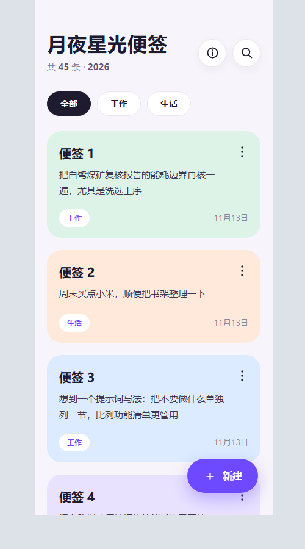
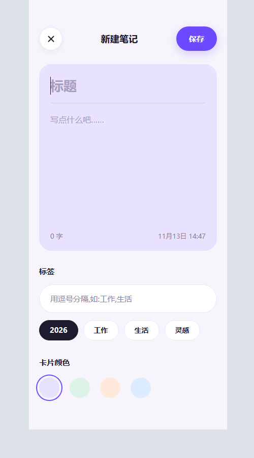
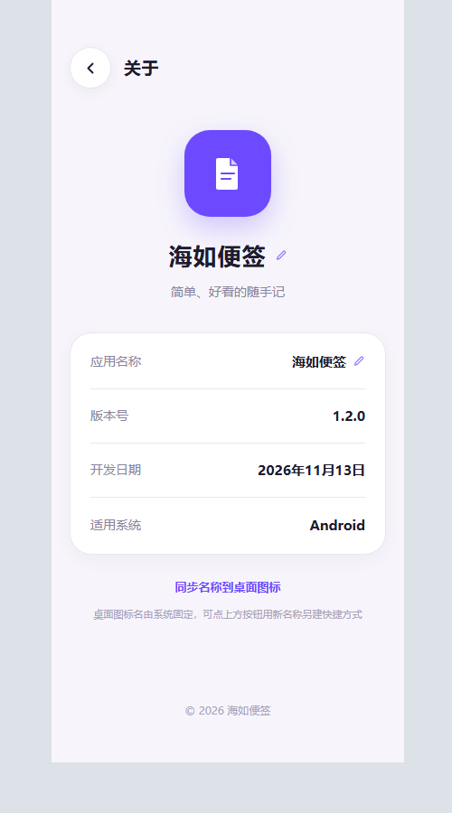

# 海如便签

> 一个只存本机的安卓便签 App：点开就写、按标签归类、零权限、断网可用。
> 目标设备：小米 Redmi Turbo 4（HyperOS / Android 14~15，ARM64）。

<p align="center">
  
  
  
</p>
<p align="center"><sub>左：列表页（截图演示的是自定义名称「月夜星光便签」，默认名为「海如便签」） · 中：新建/编辑页 · 右：全屏关于页</sub></p>

---

## 一眼看懂

| 项 | 值 |
| --- | --- |
| 应用名 / 包名 | 海如便签（可在关于页自定义） / `com.hairu.idea` |
| 版本 | `1.2.0`（versionCode 3），发布于 2026 年 11 月 13 日 |
| 系统要求 | minSdk 26（Android 8.0） / targetSdk 34，纯 Java + WebView，无 native 库 |
| 权限 | **零权限**，连 `INTERNET` 都没声明 |
| 网络 | 无登录、无云同步、无广告、无任何网络请求 |
| 数据 | 只写应用私有目录的 `notes.json`，卸载才会清除 |
| 体积 | APK 约 33 KB（界面是单文件 HTML，无第三方 SDK） |
| 签名 | 自有 RSA-2048 密钥，v1 + v2 + v3，`apksigner verify` 通过 |

仓库里 **`HaiRuNotes-v1.2.0.apk` 已编译、对齐并签名，可直接安装**。

---

## 功能

**只有三个页面**，没有启动页、引导页、登录页和多余设置页。

### 列表页
- 左上大标题（可自定义）、`共 N 条 · 年份`；右上 ⓘ 关于、搜索两个圆形按钮
- 搜索按标题 / 正文 / 标签实时过滤；标签筛选胶囊只显示实际用过的标签
- 淡紫 / 淡绿 / 淡橙 / 淡蓝四种彩色卡片，正文两行截断，右上 ⋮ 提供编辑 / 删除（删除有二次确认）
- 右下悬浮「＋ 新建」；列表底部「导出备份 · 导入备份」
- **列表分页**：默认每页 20 条，可点翻页条下方小字循环切换 **20 / 15 / 30**，偏好记在本机。只有 1 页时翻页条自动隐藏；切换标签、搜索、新建保存、导入备份都会回到第 1 页；删空末页自动回退；导出备份和顶部计数始终是全部便签

### 新建 / 编辑页
- 全屏大卡片，颜色随所选卡片联动；标题、正文、左下字数、右下日期时间
- 多标签：逗号分隔输入 + 预设胶囊（当年年份 / 工作 / 生活 / 灵感），新建时默认选中当年年份
- 四个颜色圆点选卡片颜色；右上紫色「保存」胶囊
- 全新安装首次打开会**直接进这一页并弹出键盘**

### 关于页（独立全屏页）
- 返回按钮、紫色文档 Logo、大字应用名、副标题
- 四行信息卡：应用名称 / 版本号 / 开发日期 / 适用系统，底部版权
- **改名**：点大字应用名或「应用名称」行（带小铅笔）打开输入框，最多 12 字，可「恢复默认」。改一处，以下位置全部联动：列表大标题、关于页名称与版权、网页标题、系统「最近任务」标题、导出备份内容与文件名、长按图标的动态快捷方式
- 「同步名称到桌面图标」按钮：用新名字另建一个桌面快捷方式

> **系统限制**：Android 把启动器图标名写死在 APK 资源表里，运行时不允许改写，因此采用标准 `requestPinShortcut` 方案。小米 HyperOS 会弹确认框，需允许「创建桌面快捷方式」；桌面不支持时 App 内名称不受影响。

### 其他
- 物理返回键按层级分发：关弹层 → 关于/编辑页回列表 → 列表页才退出
- 旧版单标签数据自动迁移为标签数组，不会丢
- 背景 `#F7F5FB`、墨色 `#1E1B2E`、主紫 `#6D4AFF`，配色来自界面参考图

---

## 安装到手机

1. 把 `HaiRuNotes-v1.2.0.apk` 传到手机：**数据线 / 小米互传 / QQ 最稳，别用微信**（微信会把 APK 改名成 `.apk.1` 导致无法安装）。
2. 在「文件管理」里点这个 APK → 安装。
3. 首次提示「禁止安装未知来源应用」时，点**设置** → 打开「允许来自此来源的应用」→ 返回继续。
4. 若被「纯净模式」拦截：设置 → 应用设置 → 纯净模式 → 临时关闭，或点「仍要安装」。
5. 装完桌面出现紫色图标。**升级时直接覆盖安装**，便签数据不会丢（前提是签名密钥没换）。

不想装 APK 时，把 `app/index.html` 用浏览器打开也能用，数据存在浏览器 localStorage，与 APK 版不互通。

---

## 数据与备份

| | APK 版 | 网页版 |
| --- | --- | --- |
| 存储位置 | `/data/data/com.hairu.idea/files/notes.json` | 浏览器 `localStorage`（key `turbnotes_v2`） |
| 清除时机 | 仅卸载 | 清除网站数据 |

- 每条便签：标题、正文、标签数组、卡片颜色、创建时间；应用名称单独存在 `appName` 字段。
- **导出**：列表底部「导出备份」→ 系统分享，文件名为 `<应用名>_备份_YYYYMMDD.json`。格式为 `{app:"HaiRuNotes", version:3, appName, notes, tags}`，始终是全部便签，不受分页影响。
- **导入**：粘贴备份内容 → 「从剪贴板读取」→ 确认导入；**合并而非覆盖**，兼容旧版备份，并会一并恢复自定义应用名。
- 换机、清数据、卸载之前，一定先导出。

---

## 从源码构建

### 路线 A：本地一键脚本（推荐，约 5 秒，不联网）

前置：JDK 17 + Git Bash + curl + Python。

```bash
git clone https://github.com/tyrains/hairu-notes.git
cd hairu-notes
bash android/build-local.sh
```

脚本依次完成：同步 `app/index.html` → `aapt2 compile/link` → `javac` → `d8` → 组装 `classes.dex` + `zipalign` → `apksigner` 签名 → 验签，输出 `HaiRuNotes-v1.2.0.apk`。

- 不需要 Gradle、Android Studio 或任何 Maven 依赖；`android/*.gradle` 只是给 IDE 路线准备的。
- 首次在新机器上会自动下载两份官方 SDK 组件到 `~/.tnbuild-sdk` 并长期复用。
- 中间产物刻意放在纯 ASCII 临时目录：`aapt2` / `zipalign` 处理中文路径会报 `bad resource path`。

### 路线 B：GitHub Actions 云端出包

`.github/workflows/build-apk.yml` 在 push 到 `main` 或手动 **Run workflow** 时触发，产物在 Actions 运行记录的 **Artifacts** → `海如便签-APK`（zip，需解压出 `.apk`）。

### 路线 C：Android Studio

Open → 选 **`android/` 目录**（不是仓库根目录）→ Gradle 同步 → **Build → Build APK(s)**。

> **签名一致性**：路线 B / C 用的是各自生成的 debug 密钥，与仓库内这个已签名 APK 不同，**不能直接覆盖安装**（会报签名冲突，须先卸载，数据会丢）。日常迭代固定用路线 A。

### 关于签名密钥

`android/turbonotes.jks` **不在本仓库**（`.gitignore` 已排除 `*.jks` / `*.keystore` / `*.zip`），本地另有保留。clone 后若密钥缺失，`build-local.sh` 会自动新建一把，能正常出包，但新签名只能卸载重装。同包名的后续版本必须用同一把密钥签名才能覆盖升级，所以本地那把密钥别删、换电脑时一起带走。签名口令同样不入库，由本地 `android/signing.local.conf` 提供（已加入 `.gitignore`）；未配置时脚本会用占位口令自动生成新密钥。

---

## 目录结构

```text
README.md                                  本文件
HaiRuNotes-v1.2.0.apk                      ★ 成品，已对齐 + 已签名，可直接安装
app/index.html                             App 本体：界面 + 逻辑，单文件零依赖
android/
  build-local.sh                          ★ 本地一键出包
  app/src/main/AndroidManifest.xml        零权限声明、单 Activity
  app/src/main/java/com/hairu/idea/MainActivity.java   WebView 壳 + JS 桥 + 键盘 + 返回键 + 名称同步
  app/src/main/assets/index.html          ↑ 与 app/index.html 同一份，脚本自动同步
  app/src/main/res/                      默认应用名、紫色图标（5 档 PNG + 自适应图标）
  app/build.gradle / build.gradle / settings.gradle / gradle.properties   IDE 路线用
.github/workflows/build-apk.yml           GitHub Actions 云端出包（备选）
_refs/                                     两批参考图与各版对照截图
提示词.md                                  成品提示词 + 写法拆解
使用说明.md                                完整安装、备份、排障说明
```

> 本地另有的 `android/turbonotes.jks`（签名私钥）与 `海如便签-源码.zip`（含该私钥）出于安全考虑未上传。

---

## 技术实现

- **单 Activity + WebView**：`MainActivity` 加载 `assets/index.html`，用 `@JavascriptInterface` 暴露 `load / save / share / paste / showKeyboard / hideKeyboard / setAppName / pinShortcut` 给页面调用。
- **状态单一数据源**：`state.appName` 一处修改，`applyAppName()` 统一刷新所有显示位置并持久化到 `notes.json`。
- **手工 APK 工具链**：绕开 Gradle，直接 `aapt2` → `javac` → `d8` → `zipalign` → `apksigner`，因此整个工程无第三方依赖、无网络构建步骤。
- **升级版本号要同步三处**：`app/index.html` 的 `APP_INFO.version`、`android/app/build.gradle`、`android/build-local.sh`。

## 常见问题

| 现象 | 处理 |
| --- | --- |
| 提示「应用未安装」 | 多半是微信把 APK 改名了，改用数据线重传 |
| 提示「签名冲突」 | 装过路线 B / C 的 debug 包：先导出备份 → 卸载 → 装本地版 → 导入备份 |
| 提示「解析软件包时出现问题」 | 云端下载的是 zip，要先解压出 `.apk` |
| 桌面图标名没跟着改 | Android 系统限制，用关于页「同步名称到桌面图标」另建快捷方式 |
| 想换配色 / 字号 | 只改 `app/index.html` 中 `:root` 变量与 `PALETTE` 数组，重新出包即可 |

---

个人自用项目，用于随手记录想法；不含任何账号体系、统计或联网能力。完整使用细节见 [`使用说明.md`](使用说明.md)，提示词写法见 [`提示词.md`](提示词.md)。
